# OntoOS 技术文档 · 功能模块全景

> **版本**：v1.0.0+（含 ChatBI v3、工作流预设、界面中文化） · **更新日期**：2026-11-14
> **定位**：面向二次开发者与系统评估者的**完整技术参考**——逐个模块说明「做什么 / 怎么实现 / 边界在哪 / 怎么验证」。
> **诚实原则**：本文严格区分「真实落库实现」与「示意/登记/未接入」，所有边界照实写；与 `src/config/status.ts`（页面状态单一事实来源）和各页 `features` 横幅保持一致。

<div align="center">

[快速索引](#一快速索引) · [总体架构](#二总体架构) · [模块详解](#三模块详解42-个应用) · [横切能力](#四横切能力) · [边界总表](#五能力边界总表) · [附录](#六附录)

</div>

---

## 一、快速索引

| 域 | 模块数 | 章节 |
|---|---|---|
| 概览（应用中心 / 平台仪表盘） | 2 | [3.1](#31-概览) |
| 数据与本体 | 13 | [3.2](#32-数据与本体) |
| 知识与分析（不含概览 2 页） | 9 | [3.3](#33-知识与分析) |
| 应用与智能（10 页 + 全局智能助手） | 10+1 | [3.4](#34-应用与智能) |
| 治理与管理 | 8 | [3.5](#35-治理与管理) |
| **合计** | **42 个应用页面** | |

> **编号说明**：下文用 ①~㊺ 顺序编号，其中 ⑯ 为对象存储横切说明、㉖ 为域归属说明、㊲ 为全局侧滑智能助手（非独立路由），三者不计入 42 个应用页面；其余 42 个编号与 `src/config/nav.ts` 的 42 项一一对应。

**文档内截图**：`docs/screenshots/` 下 29 张 1440×900 真实界面截图（登录、仪表盘、建模、图谱、检索、ChatBI 四形态、工作流预设、审批、控制面板等），全部来自运行中的系统。

**配套资产**：`demo-data/FEATURE-MATRIX.md`（42 页验证矩阵）、`tests/api-contract.md`（端点契约）、`tests/smoke.mjs`（195 项黑盒断言）、`demo-data/load.mjs`（118 项幂等数据集）、`CONVENTIONS.md`（开发规范）。

---

## 二、总体架构

### 2.1 分层图

```
┌────────────────────────── 浏览器 React 18 + Vite 5 + TailwindCSS ──────────────────────────┐
│  42 个应用页面 · PageShell 统一骨架 · Canvas 画布族 · 顶栏 / 侧栏 / Ctrl+K / 智能助手 / 扫描录入  │
└──────────────────────────────────────┬────────────────────────────────────────────────────┘
                                       │ fetch（JWT + x-space-id，src/lib/api.ts）
┌──────────────────────────────────────▼────────────────────────────────────────────────────┐
│                          Hono API 服务（28 个路由组，server/index.ts:38-65）                 │
│  对象/本体 · 动作/审批/审计 · 知识(分块/向量/BM25+RRF) · 聚合分析 · 时序 · 调度求解           │
│  智能助手(22 工具) · 工作流 · Agent · 文档分析 · 函数沙箱(vm) · 扫描识别 · 治理 · 数据源       │
│  ── 引擎层 server/engine/：automation / knowledge / semantic / agentTools /                  │
│     externalSource / fileSource / functionSandbox / scanTemplates                          │
└──────────────────────────────────────┬────────────────────────────────────────────────────┘
                                       │ Drizzle ORM（SQL 下推 + 热点索引 + 游标分页）
                            ┌──────────▼───────────┐     ┌──────────────────────────┐
                            │ SQLite（better-sqlite3） │     │ 外部源（SQLite/CSV/JSON，  │
                            │ 51 张表 · WAL · 单文件   │     │ 路径白名单只读）           │
                            └──────────────────────┘     └──────────────────────────┘
                                       │
                            ┌──────────▼───────────┐
                            │ AI 网关（OpenAI 兼容）  │  ← 可配置；未配置/429 时各模块降级策略不同
                            └──────────────────────┘
```

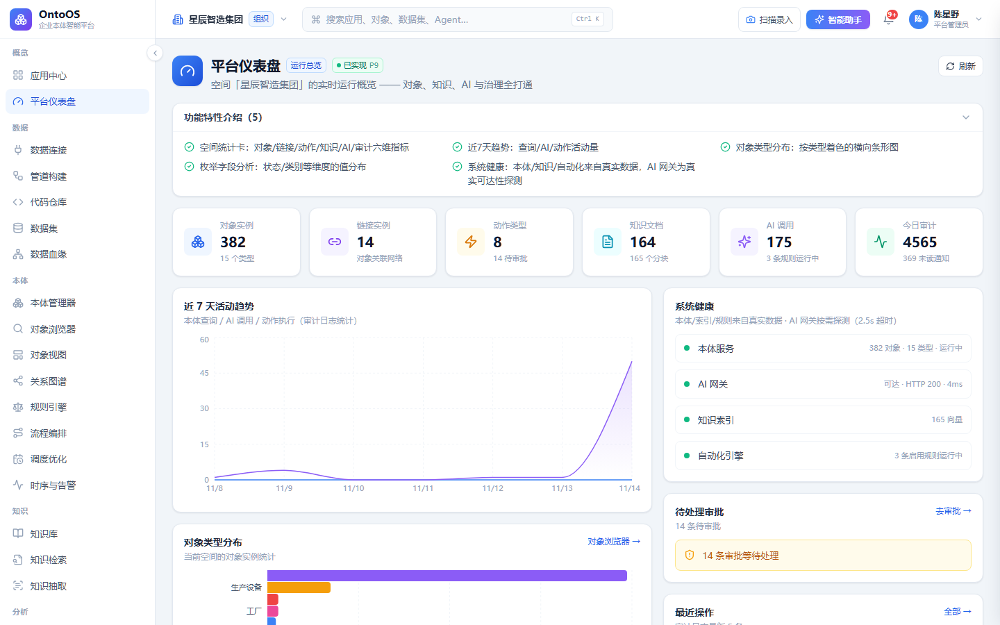

### 2.2 技术选型

| 层 | 选型 | 关键依据 |
|---|---|---|
| 前端 | React 18 · TypeScript(strict) · Vite 5 · TailwindCSS · recharts · lucide-react | 42 页全 live；`status.ts` 单一事实来源 |
| 后端 | Hono · @hono/node-server · Drizzle ORM | 28 路由组按域挂载，`server/routes/*` |
| 数据 | better-sqlite3（单文件 WAL） | 零运维；幂等迁移；升级可换 PG 方言 |
| 认证 | JWT(HS256) + bcryptjs + API 密钥(SHA-256) | 多空间行级隔离；无吊销（边界见 §5） |
| 知识 | BM25 + 向量余弦 + RRF 融合 | 远程 embedding + 本地 256 维哈希降级 |
| AI | OpenAI 兼容网关（端点/密钥/模型存 `settings`） | 双引擎/规则摘要/草稿重试多种降级 |
| 函数 | `node:vm` 沙箱 | 2s 超时 + 禁 eval/constructor 逃逸 |

### 2.3 数据模型要点

`server/schema.ts` 定义 51 张表（50 张业务表（schema.ts 定义、migrate.ts 幂等建）+ 1 张 drizzle 迁移元数据表）。核心：

- **本体**：`object_types`（`properties` JSON 动态属性）、`link_types`、`action_types`、`ontology_functions`、`interface_types`、`ontology_terms`
- **实例**：`objects`（`values` JSON 通用存储）、`object_links`；热点索引 `idx_objects_space_type` / `idx_objects_space_updated`（`migrate.ts:146-152`）
- **知识**：`documents` / `doc_chunks`（embedding base64 + dim）/ `doc_links` / `extract_candidates`
- **AI**：`ai_conversations`（scene=assist/agent/thread）/ `ai_messages` / `settings`（JSON 配置口袋）
- **运行**：`audit_events` / `action_logs` / `approvals` / `notifications` / `pipeline_runs` / `ts_points` / `schedule_tasks` / `deployments`

### 2.4 多空间与权限（贯穿全栈）

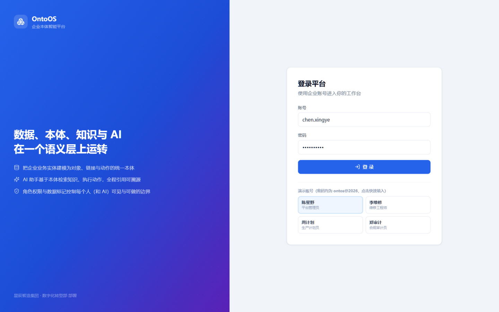

- 前端 `src/lib/api.ts` 自动注入 `Authorization: Bearer <jwt>` 与 `x-space-id`
- 后端 `resolveSpace(c, user)`（`server/space.ts:41`）校验成员资格；`spacePerm(user, space, typeId)`（:63）返回 `full/read/none`；`spaceCanModel` 控制建模写权限
- 组织 / 个人 / 家庭三类空间，行级隔离（部署级隔离为不同实例/DB，见 §5）
- 角色对象权限回退规则前后端一致：显式 `objectPerms[typeId]` 优先；未配置新类型按角色 `admin/data-eng→full`、其他→`read`

---

## 三、模块详解（42 个应用）

> **阅读约定**：每个模块按「功能 / 原理 / 边界 / 验证」四段描述。API 路径省略 `/api` 前缀；`src/config/status.ts` 中 42 页均为 `live`。

### 3.1 概览

#### ① 应用中心 `/launcher`

- **功能**：42 应用按业务域分组入口；收藏与最近访问（localStorage）；应用状态圆点来自 `statusOf(path)`；全局搜索 Ctrl+K。
- **原理**：纯前端 + `src/config/nav.ts` 的 `NAV_GROUPS` / `findNav` + `src/config/status.ts`；收藏/最近写入 `localStorage`（`ontoos_favorites` / `ontoos_recent`，含损坏数据兜底，`Launcher.tsx:17-49`）。无后端接口。
- **边界**：收藏/最近是**本地浏览记录，非服务端统计**（页面明示）；状态圆点是静态配置，非运行时探测。
- **验证**：`FEATURE-MATRIX.md` 概览 1；截图 `launcher.png`。


#### ② 平台仪表盘 `/overview`

- **功能**：六维统计卡（对象/链接/动作/知识/AI 调用/今日审计）、近 7 天活动趋势、对象类型分布、枚举字段分布、系统健康（含 AI 网关真实探测）、待审批与最近操作。
- **原理**：`GET /dashboard/overview`（`dashboard.ts:35-123`）聚合十余张表；趋势按 `audit_events.action` 关键字（查询/AI/动作）按天计数；AI 网关 `probeGateway` 用 `GET {endpoint}/models` 2.5s 超时，**任何 HTTP 响应（含 401/404）都算可达**（`dashboard.ts:23-33`）。
- **边界**：`自动化引擎` 健康项 `ok:true` 无条件为真（0 条规则也显示运行中）；`pendingApprovals` / `notifications` 未按空间过滤；趋势按字符串关键字分类，口径较粗。
- **验证**：smoke `GET /dashboard/overview`；截图 `overview.png`。

---

### 3.2 数据与本体（13 个）


#### ③ 数据连接 `/data/connections`

- **功能**：连接登记 CRUD（14 种类型）；SQLite 外部库 / CSV、JSON、TXT、MD 文件源**真实探测**（表清单、列预览）；表数据预览（≤20 行）；同步为本体对象；全量健康检查。
- **原理**：`server/routes/dataLayer.ts`（`/connections` CRUD、`/test`、`/tables`、`/preview`、`/sync`）；`server/engine/externalSource.ts` 路径白名单 `demo-data/external/` + `readonly:true, fileMustExist:true`，读 `sqlite_master`，同名属性映射、`JSON.stringify(values)` 幂等去重、**同步上限 500 行**；`server/engine/fileSource.ts` 白名单 `demo-data/files/`，自研 CSV 解析（BOM/CRLF/引号/`""` 转义）、JSON 顶层数组/对象分表、TXT/MD 按行拆列。落 `data_connections` / `objects` / `audit_events`。
- **边界**：**仅 SQLite + 4 类文件源真实可用**；MySQL/PG/Oracle/SQLServer/Kafka/S3/REST/SAP **仅登记参数**，页面明示不发起真实连接；预览 20 行 / 同步 500 行；无凭据代理、无内网驱动。
- **验证**：load.mjs「外部数据源全链路」；截图 `data-connections.png`。

#### ④ 管道构建 `/data/pipelines`

- **功能**：管道定义 CRUD（nodes/schedule/version/status）、**真实节点编辑画布**（渲染选中管道的真实 nodes；拖拽布局 / 连接模式建线 / 点连线删除 / undo-redo（Ctrl+Z）/ 滚轮缩放平移 / 添加删除节点，「保存布局」把坐标与连线随定义持久化）、结构校验、发布（版本+1）、运行与最近 10 次运行历史、知识管道指标。
- **原理**：`server/routes/p10plus.ts:179-276`，列表返回每条管道的 `nodes` 全量；节点坐标/连线存于 `config.x/y/next`，随 `POST /pipelines` 持久化；`validate` 纯结构检查（必须有 source 与 output/sink 节点）；`run` 真实执行程度是**扫描当前空间对象数**并写一条 `pipeline_runs`。
- **边界**：**运行不执行真实 ETL/转换节点**（画布编辑的是定义而非执行引擎）；`schedule` 字段仅存储，无定时调度器；节点连线为单 `next` + 顺序回退（无并行分支）。
- **验证**：smoke `POST /pipelines/:id/validate` / `run`；浏览器实测添加节点→undo/redo→建线→保存→刷新布局仍在（7/7）；截图 `pipelines-editor.png`。

#### ⑤ 代码仓库 `/data/code`

- **功能**：代码资产登记（path/lang/branch/content）、在线查看与编辑保存、删除、按分支分组浏览。
- **原理**：`dataLayer.ts:264-316` 的 `/repo` CRUD，落 `repo_files`（`branch` 默认 main），写操作 `spaceCanModel` + 审计。
- **边界**：**轻量代码资产登记，非 Git 集成**——PR 审查、分支合并、CI 状态明确禁用（页面灰显「新建 PR」并标注）；无 commit / 版本历史 / 在线执行。
- **验证**：smoke `POST /data-layer/repo`。

#### ⑥ 数据集 `/data/datasets`

- **功能**：对象类型即数据集；实例预览（动态列 ≤20 行）、数据质量健康检查、Schema 查看。
- **原理**：`dataLayer.ts:208-261` 遍历 `object_types` 生成 `ds_${typeId}`，`rowCount` 真实计数，`health.emptyRate` 基于真实对象空值计算，预览按 `properties` 映射列。
- **边界**：`health.dupRate=0.1`、`freshnessMinutes=6` 与「主键非空/枚举合法」两项为**规则化固定结论**，非逐行扫描；预览最多 20 行。
- **验证**：smoke `GET /data-layer/datasets`；截图 `datasets.png`。

#### ⑦ 数据血缘 `/data/lineage`

- **功能**：四层血缘图谱（数据源→链接处理→下游应用→知识消费）、应用↔类型真实依赖连线、选中节点影响分析、滚轮缩放/平移拓扑；**规模控制**（默认每层只画规模最大的 8 个代表性节点，其余聚合为可点击的「+N」节点；「完整视图」每层上限 40，超出部分保留在右侧列表检索）。
- **原理**：后端 `p10plus.ts` 提供四层节点（`object_types` / `link_types` / `workshop_apps` / `documents`）与 `appDependencies`；**拓扑计算在前端** `Lineage.tsx`：四列固定 X，`MIN_GAP=76` 居中铺开，画布高度按**实际绘制行数**计算（不再被上百个文档分块拉爆）；`GraphCanvas` / `ZoomableCanvas` 负责缩放平移。右侧「选择节点」列表保留全量数据可检索，影响分析按依赖类型对象数求和。
- **边界**：「输出应用→知识文档」连边按索引循环生成，是**示意层间连线**；无字段级/列级血缘、无跨空间血缘；图谱默认不画全量节点（事无巨细的展示交由右侧列表与影响分析），完整视图亦有硬上限防大空间卡顿。
- **验证**：浏览器实测 5/5（默认 29 节点 / 90 折叠 / 点「+N」展开 / 完整视图切换 / 大规模数据页面正常）；截图 `lineage.png`。

#### ⑧ 本体管理器 `/ontology/manager`

- **功能**：对象类型（属性/必填/枚举/主键/展示模板）、链接类型、动作类型、函数、接口契约、业务术语**六个 Tab**；接口符合性校验；函数版本/测试/发布/回滚/run；文档智能识别导入。
- **原理**：`server/routes/ontology.ts` 的 `/types|links|actions|functions|interfaces|terms` CRUD；接口校验对 `implementedBy` 每个类型比对契约属性是否缺失（`ontology.ts:384-395`）；安全删除（有实例/被引用 → 409）；函数沙箱见 [§4.2](#42-函数沙箱与工作流)。落 `object_types` / `link_types` / `action_types` / `ontology_functions` / `function_versions` / `interface_types` / `ontology_terms`。
- **边界**：函数仅 JavaScript；`ontology_functions.body` 初始为占位注释；业务术语语义层见 [§4.1](#41-智能助手与语义层)；无 TS/Python 多语言、单测、函数支撑动作与流式。
- **验证**：smoke 本体 CRUD + `/interfaces/:id/check`；截图 `ontology-manager.png`。

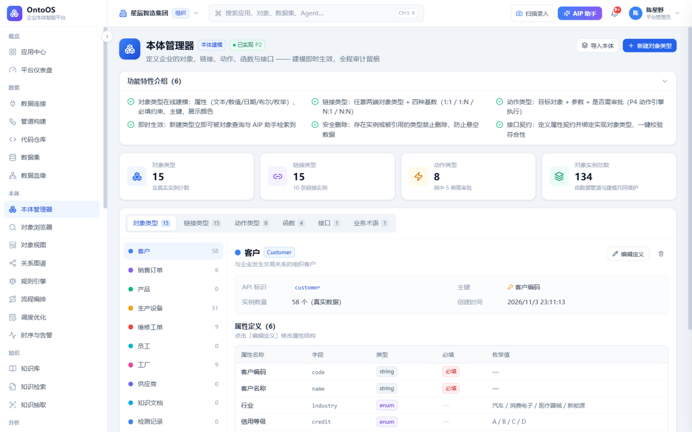

#### ⑨ 对象浏览器 `/ontology/explorer`

- **功能**：单类型表格工作台（实例真实增删改查 + 动态列）、关联管理、保存的探索（过滤/排序/运行）、对象集比较、派生属性、场景分支（暂存→合并/放弃）、扫描录入。
- **原理**：`server/routes/objects.ts` 实例 CRUD（属性校验 + 权限），`server/routes/explorations.ts` 高级能力：`normalizeFilters` 仅允许 `eq/contains/gt/lt`、`matches()` AND 判定、**运行上限 50**；派生属性用 `FORBIDDEN_EXPR` 正则黑名单 + `new Function('v','return '+expr)`（`explorations.ts:127-130,321`）；场景变更暂存进 `ontology_scenarios.changes`，`mergeScenario` 整体校验权限后真实写 `objects` + 清理链接 + 触发事件。
- **边界**：探索运行最多 50；派生属性用正则黑名单而非 vm 隔离，安全性弱于函数沙箱；缺 SQL 分析 / 保存列表共享 / 对象集 Service。
- **验证**：smoke 对象写闭环 + 场景；截图 `object-explorer.png`。

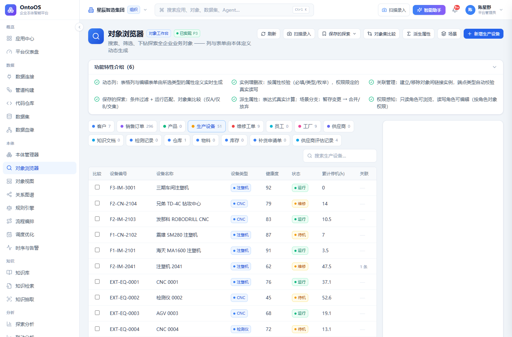

#### ⑩ 对象视图 `/ontology/views`

- **功能**：跨类型全局搜索、卡片画廊（按类型分组）、展示模板在线配置（titleKey/subKey/badgeKey）即时预览与保存。
- **原理**：`GET /objects/search`（`objects.ts:251-274`）按 `q` 大小写不敏感包含匹配、`type` 多类型过滤、按类型分组每组取前 N；模板存 `object_types.viewTemplate`（`PATCH /ontology/types/:id`）。
- **边界**：`GET /search` 是**全表读入内存后 JS 过滤**（非 SQL 下推）；每组默认 8/4、上限 50；无全文索引/分页/跨空间搜索。
- **验证**：smoke `GET /objects/search`。

#### ⑪ 关系图谱 `/ontology/graph`

- **功能**：真实对象节点 + 链接边的力导向图谱、类型/关键词筛选与图例、选中节点属性与关联详情。
- **原理**：`GET /objects/graph`（`objects.ts:170-212`）`limit` 上限 120、边只保留两端都在截断节点集内、返回 `truncated`；**前端确定性 Fruchterman-Reingold 变体**（`VertexGraph.tsx:29-156`）：按 typeId 分簇圆周布心，260 次迭代（两两斥力 `repulsion/d²`、边弹簧引力、簇心弱聚拢 + 温度退火限幅、45% 后强制 `minDist=46` 分离防堆叠），无随机数 → 刷新稳定。
- **边界**：页面固定请求 `limit=60`、后端上限 120；`GET /graph` 与关键词匹配也是全表内存过滤；布局为前端纯计算，非服务端求解。
- **验证**：smoke `GET /objects/graph`；截图 `graph.png`。

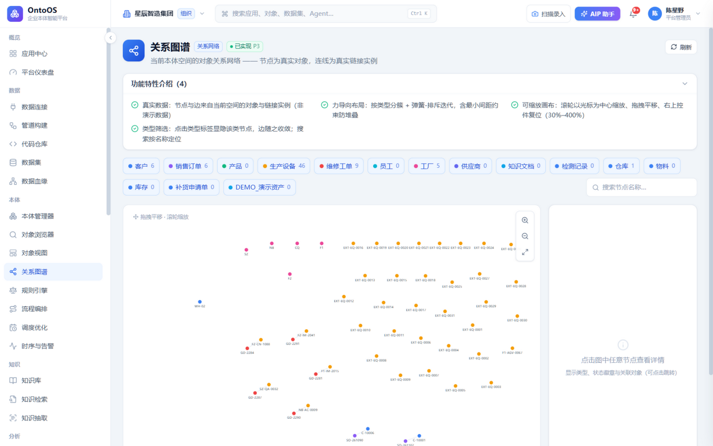

#### ⑫ 规则引擎 `/ontology/rules`

- **功能**：规则列表（作用对象/触发条件/动作/累计命中量）、新建（触发配置 + 多行条件构建器）、启停/删除、触发历史与命中分析。
- **原理**：`server/routes/automations.ts` CRUD + `server/engine/automation.ts` 的 `fireObjectEvent`（对象 create/update/delete 后由 `objects.ts` / `explorations.ts` 调用）；`matchCondition` 用正则解析**单条**「字段 操作符 值」表达式，两侧数值则数值比较，否则字符串比较；命中写 `hitCount+1` + `audit_events`；动作 `notify` / `create_action` / `hold_approval`。
- **边界**：**前端 `serializeCondition` 产出 `A > 1 AND B < 2` 多行 AND 串，但引擎只解析单条表达式**，多条件不会逐条求值（解析失败按满足处理）；`trigger.kind='schedule'`（cron）类型定义了但引擎不执行；无独立定时轮询/流式处理。
- **验证**：smoke 自动化规则 CRUD + 触发。

#### ⑬ 流程编排 `/ontology/machinery`

- **功能**：双 Tab——① **流程编辑器**：可视化编排业务流程（开始 / 执行动作 / 人工审批 / 发送通知 / 结束五类节点），点选节点编辑名称/动作绑定/后继、添加删除节点、拖拽布局、连接模式建线、点连线删除、undo/redo（Ctrl+Z / Ctrl+Shift+Z）、滚轮缩放平移、保存/删除流程；执行动作节点可绑定本体已登记的真实动作类型（显示审批标识）。② **动作链观测**：每个 `actionType` 的执行次数/待审批数/近期执行日志与观测画布（滚轮缩放）。
- **原理**：自定义流程存 `settings.key='machinery_flows_${spaceId}'`（`GET/POST /p10plus/machinery/flows`、`DELETE /:id`），保存校验节点 id 唯一/类型合法/`next` 目标存在/绑定动作存在；观测侧 `p10plus.ts` 从 `actionTypes` + `actionLogs` 真实聚合 `execCount` / `pendingCount`。
- **边界**：流程定义可编辑持久化，但**不驱动动作引擎执行**（与「工作流编排」不同：那里是真实执行链）；连线为单 `next` + 顺序回退（无并行分支）；观测画布只读。
- **验证**：smoke 195/195（流程 CRUD/回读/断链 400/空节点 400）；load 118/118；浏览器实测 9/9（点选/添加/undo/建线/保存/刷新回读/观测 Tab）；截图 `machinery-editor.png`。

#### ⑭ 调度优化 `/ontology/scheduling`

- **功能**：排程任务 CRUD、本地启发式求解（建议 + 冲突）、应用方案、真实指标（利用率/准时率/延期数）+ 甘特图、演示数据 seed。
- **原理**：`server/routes/scheduling.ts`：约束常量 `HORIZON_DAYS=7` / `CAPACITY_H=24`（F2 精密线第 3 天检修扣 4h）；`POST /solve`（:266-353）**贪心排序**（priority 升序 → A 级客户优先 → qty 降序）→ 逐任务在 7 天内找最早满足「同产线同天累计 ≤ 当日产能」的窗口 → 放不进如实进 `conflicts`；`POST /apply/:planId` 建议→已应用 + 原基线归档；`GET /metrics` 实时聚合。落 `schedule_tasks` / `deployments`（审计）。
- **边界**：**本地启发式可行解，非 COPT/OR-Tools 最优解**（页面与 status note 反复标注）；不接外部排产主数据；17 条 seed 为演示集；7 天视界、无软约束权重/多目标优化。
- **验证**：load.mjs 模块 5；截图 `scheduling.png`。

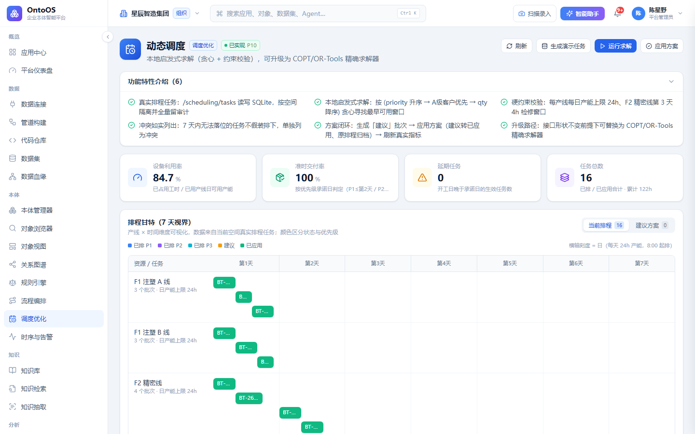

#### ⑮ 时序与告警 `/ontology/timeseries`

- **功能**：模拟曲线（24h 确定性微抖动）、真实采集（从对象批量 / 单点写 `ts_points`）、真实序列曲线（与模拟并列标注）、告警规则启停 + 通知事件。
- **原理**：`p10long.ts:99-137` 用 `sin/cos` 生成**确定性波动**历史（明确「非真实采集」）；`server/routes/platformOps.ts:56-196` 是真实采集：`POST /ops/timeseries/collect`（校验对象属当前空间后 `onConflictDoNothing`）、`collect-from-objects`（按 `valueKey` 批量、`t` 小时对齐）、`GET /series`（按 metric 分组）；`ts_points` 唯一索引 `(metric,objectId,t)`。
- **边界**：模拟曲线不是真实历史；**无设备直连采集与 streaming 管道**；`ts_points` 无 space_id，靠关联 `objects.objectId` 过滤空间；`notifications` 无 spaceId（p10long 取全局最近 8 条）；points limit 1000 / series 2000。
- **验证**：load.mjs 模块 3；smoke 时序采集。

#### ⑯ 数据安全补充：对象存储与规模（横切，见 §4.5）

`GET /objects`（`objects.ts:103-167`）把空间/类型/游标/关键词过滤**下推到 SQL**：`eq(spaceId)` + `eq(typeId)` + `lt(updatedAt, cursor)` + `lower(values) like`；`orderBy(desc(updatedAt)).limit(limit+1)` 多取一条判 `hasMore`，`limit` 上限 200；`total` 用不含游标的 `count(*)`。`POST /objects/bulk`（:329-362）单次最多 **20 万行**，`sqlite.prepare` + 事务 + 逐行 `validateValues` + `Set` 幂等去重。10 万行基准：灌入 726ms / 列表 0.3ms / count 5.4ms（`demo-data/stress.mjs`）。

---

### 3.3 知识与分析（11 个）


#### ⑰ 知识库 `/knowledge/library`

- **功能**：文档入库（粘贴正文或 .txt/.md）、语义分块 → 向量化 → 索引；文档 CRUD、分类 Tab、统计卡、重建索引、删除级联；文档↔业务对象挂接；分块数与向量模式回执。
- **原理**：`server/routes/knowledge.ts` + `server/engine/knowledge.ts`：`chunkText(text, maxLen=260, overlap=50)` 按空行/句末标点切分、块间保留 50 字重叠（:14-48）；`indexDocument` 调远程 embedding，失败静默降级本地 256 维 FNV-1a 哈希词袋（:52-74），`Float32Array` → base64 存 `doc_chunks.embedding`；挂接写 `doc_links`。
- **边界**：仅 `.txt/.md` 经 FileReader 读取，**不解析 PDF**（`documents.format` 默认 PDF 只是标签）；本地哈希向量是字符 n-gram 词袋、**无语义泛化**；远程模型更换后旧分块因维度不符退出语义路，需重建索引。
- **验证**：load.mjs 知识库断言；截图 `knowledge-library.png`。

#### ⑱ 知识检索 `/knowledge/search`

- **功能**：BM25 关键词 + 向量语义双路召回、RRF 融合排序；混合/纯关键词/纯语义三模式；结果溯源到文档 + 分块序号 + 命中方式 + 相关度，关键词高亮；片段可作 AI 引用来源。
- **原理**：`knowledge.ts:194-248` + `engine/knowledge.ts`：`bm25(k1=1.5,b=0.75)`（英文按词、中文 2-gram，IDF `ln(1+(N-n+0.5)/(n+0.5))`）、`cosine`（维度不符跳过）、`rrfFuse(k=60)` 对两路排名累加 `1/(60+i+1)`；两路各取前 30、`limit` 上限 30；展示 score 是 `vecScore*100 + kwScore*10` 启发式。
- **边界**：本地哈希非语义；`engine` 字段按「是否配置远程」而非本次实际引擎报告（远程失败降级时仍显示 remote，**口径不一致**）；无全文索引、无分页。
- **验证**：smoke `GET /knowledge/search?q=...`；截图 `knowledge-search.png`。

#### ⑲ 知识抽取 `/knowledge/extract`

- **功能**：选已入库文档 → 真实 LLM 识别候选实体/关系 → 落 `extract_candidates`；候选审核（接受/拒绝/统计）；「落地为本体类型」真实建 `object_types` / `link_types`；向量索引统计。
- **原理**：`server/routes/extract.ts`：`llmComplete(EXTRACT_SYSTEM, doc.content.slice(0,6000))` 自由文本建议 + `deriveName` / `deriveEndpoints` 正则启发式命名（去括号、取箭头右段、引号专名）；落地实体 → 仅 1 个 `name` 属性的类型，关系 → 一条 `linkTypes`（缺两端类型自动补齐）；幂等两重：`audit_events.detail.candidateId` 历史 + 名称查重。
- **边界**：不是 NER/关系抽取模型，是「LLM 自由文本建议 + 正则清洗」；落地类型**不生成字段/属性**；候选数上限 8、文档截断 6000 字。
- **验证**：load.mjs 抽取候选断言。

#### ⑳ 探索分析 `/analytics/contour`

- **功能**：对象类型 → 分组维度（enum/date/string）→ 数值指标 → 运行聚合；日/周/月/季分桶 + 时间窗 + 排序；柱图 + 饼图 + 明细表同源展示，占比条与已应用条件回显。
- **原理**：`GET /dashboard/aggregate`（`dashboard.ts:125-320`，参数完整语义见 [§4.3](#43-chatbi-与聚合引擎)）；前端一次 `runAnalysis()` 把参数拼 URL，结果存单一 state，三个组件读同一 `result.groups`（`Contour.tsx:167-225`）。数据源特意用 `/ontology/types`（含 `properties`），避免 `/objects/types` 缺 properties 导致下拉为空的历史 bug。
- **边界**：图表「联动」本质是**同源一次刷新**，点击柱子不过滤其他组件；UI 未暴露 `top/compare/crossBy`（v2/v3 仅 ChatBI 与直接 API 可用）；无交叉过滤。
- **验证**：smoke `/dashboard/aggregate` 分桶/排序/范围；截图 `contour.png`。

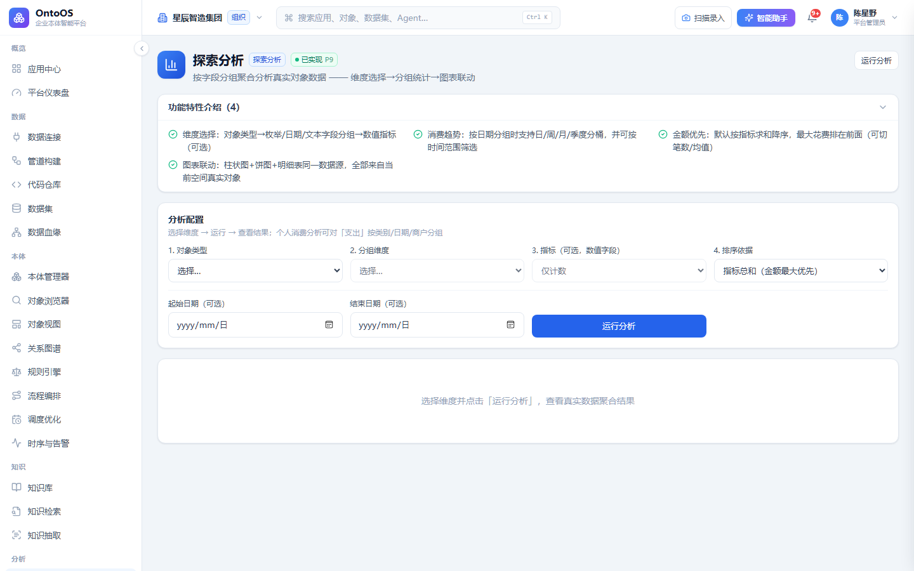

#### ㉑ 联动分析 `/analytics/quiver`

- **功能**：跨类型关键词搜索 + 类型筛选服务端下推；选中对象属性下钻（枚举徽章着色）；变更时间线（该对象最近 10 条审计）。
- **原理**：`GET /objects/search?type=` + `GET /dashboard/timeline`（取对象 + 类型 properties + `audit_events` 中 `target.includes(id)` 最近 10 条，`dashboard.ts:323-340`）。
- **边界**：仅列表 + KV + Timeline，无图谱/路径可视化；时间线靠字符串匹配 `target.includes(id)`，非结构化外键。
- **验证**：smoke `GET /dashboard/timeline`。

#### ㉒ 路径分析 `/analytics/insight`

- **功能**：五步路径（筛选设备 → 状态 → 关联工单 → 员工 → 汇总）可点击回溯；每步结果卡 + 对象数；汇总结论实时计算；重新运行路径。
- **原理**：`GET /p10long/insight`（`p10long.ts:153-200`）对固定 `device/ticket/employee` 对象做五步内存聚合，步骤 4 用紧急工单 `owner` 反查员工（查不到取前 4 名）。
- **边界**：步骤链**硬编码**不可配置；「保存为分析模板」仅 toast、「分享路径」仅复制 URL；无保存/模板表；结论是模板化文本。
- **验证**：smoke `GET /p10long/insight`。

#### ㉓ 地理空间 `/analytics/map`

- **功能**：按真实对象类型动态生成图层（点位/流向/热力显隐）、`object_links` 生成弧线、热力光晕、统计条实时重算。
- **原理**：`p10plus.ts:95-143` 用固定 `cityCoords` 查表把 `values.city/location` 映射成 x/y，`objectLinks` 取前 10 条生成弧线；`MapView.tsx` 静态 SVG viewBox。
- **边界**：`cityCoords` 是**固定城市查表**，非地理编码/GIS；抽象底图带写死区域名；无缩放平移；「新建分析视图」按钮 disabled 且注明无接口。
- **验证**：smoke `GET /p10plus/map`。

#### ㉔ 智能报告 `/analytics/notepad`

- **功能**：统计卡/类型分布表/实例分布图/最近操作全来自真实数据；智能写作（润色/续写/翻译）接真实 LLM；报告草稿/发布/列表/载入/删除落库含审计；正文可编辑、大纲导航、AI 结果随报告保存回显。
- **原理**：`/p10/notepad-data` 真实统计；`POST /p10/notepad/aip`（`p10.ts:162-186`）`action ∈ polish|continue|translate`，文本截断 8000 字 → `llmComplete` → 返回 `{action,result}`，**端点本身不落库**；落库在用户点保存/发布时把 `aipResult` 序列化进 `reports.aipResult`（`p10.ts:213-238`），载入时 `parseAip()` 兼容 JSON/旧纯文本。
- **边界**：正文是 textarea 模板化拼装，非富文本编辑器；结论/建议为规则文本；单独点润色不持久化；未配置 AI 返回 503。
- **验证**：smoke 报告草稿/发布；load.mjs 运营月报。

#### ㉕ 智能表格 `/analytics/fusion`

- **功能**：表格行来自当前空间 `factory` 对象、列映射属性；双击单元格编辑 → **真实写回本体对象** + 审计；停机超阈值行高亮。
- **原理**：`SpreadsheetGrid.tsx` 双击 → `onCellEdit` → `Fusion.tsx:45-57` → `POST /p10long/fusion/cell {objectId, field, value}` → `p10long.ts:79-94` 校验 `spaceId` 与 `typeId==='factory'` 后 `db.update(objects).set({values})` + 审计；成功后重新拉 sheet。异常高亮由 `device.downtime` 按工厂名模糊匹配求和 > 40h 得出。
- **边界**：`=ONTOLOGY.QUERY("Factory")` 等公式**仅展示文本、不求值**（页面自标「示意」）；「刷新工作表」纯 toast；写回固定 `factory` 类型固定 5 列，无字段白名单校验。
- **验证**：smoke `POST /p10long/fusion/cell`。

#### ㉖ 平台仪表盘（见 ②）· 应用中心（见 ①）

*本域 11 页中 ①② 已在前节描述，其余 9 页如上；共 11 个。*

---

### 3.4 应用与智能（10 个）

#### ㉗ 应用搭建 `/apps/workshop`

- **功能**：应用/组件/变量 CRUD、组件绑定真实对象集、编辑态实时预览。
- **原理**：`server/routes/workshop.ts`（挂 `/api/workshop`，`/apps` CRUD 与 `widgets`/`variables` 持久化见 :71-96），落 `workshop_apps`（`widgets` JSON 含 `config.typeId`）——这个字段同时是数据血缘 `appDependencies` 的来源；`spaceCanModel` 校验建模写权限。
- **边界**：组件类型与变量绑定为平台内轻量实现，非通用低代码引擎；无运行时沙箱/第三方组件市场。
- **验证**：load.mjs `设备运维监控台`；截图 `workshop.png`。

#### ㉘ 自动化引擎 `/apps/automate`

- **功能**：规则 CRUD、启停、条件表达式、执行记录；与规则引擎页共用 `automation_rules` 与 `fireObjectEvent`。
- **原理**：见 ⑫ 规则引擎；`server/engine/automation.ts:98-165` 在对象变更后触发，动作 `notify` / `create_action` / `hold_approval` 落 `notifications` / `approvals` / `action_logs`。
- **边界**：同 ⑫（多行 AND 不逐条求值、cron 触发器未执行）。
- **验证**：smoke 自动化规则；load.mjs 自动化。

#### ㉙ 岗位工作区 `/apps/carbon`

- **功能**：把多个应用组合为岗位专属工作台（磁贴来自真实 Workshop 应用列表）。
- **原理**：`p10plus.ts` 读 `workshop_apps` 真实列表生成磁贴；`status.ts` note「磁贴来自真实应用列表」。
- **边界**：聚合展示层，无独立布局持久化引擎；磁贴顺序/分组不是用户可深度定制的仪表盘产品。
- **验证**：smoke `GET /p10plus/carbon`。

#### ㉚ 应用市场 `/apps/marketplace`

- **功能**：模板包/产品目录 CRUD、上架下架、安装计数、分类。
- **原理**：`p10plus.ts` marketplace 段，落 `marketplace_products`；目录由真实表驱动（非静态常量）。
- **边界**：安装是登记/计数语义，非真实拉取远程包或执行安装脚本；无版本仓库/签名校验。
- **验证**：load.mjs「上架产品」；截图 `marketplace.png`。

#### ㉛ 工作流编排 `/aip/logic`

- **功能**：可视化节点编排（点选编辑/拖拽布局/上移下移/复制/删除确认）、**画布滚轮缩放 / 空白拖拽平移 / 复位 / 百分比**、**undo/redo（按钮 + Ctrl+Z / Ctrl+Shift+Z）**、**连线控制**（连接模式点两节点建 `next`、点已有连线删除确认、条件节点「是/否」目标可编辑）、6 个开箱即用预设（4 个离线可跑）、保存/删除/**预览运行 → 确认 → 真实执行**、逐步执行记录与动作结果、另存副本。
- **原理**：`server/routes/logic.ts` + `shared/workflowTemplates.ts`：`transform` 离线节点（extract 提数值 / keyword 命中标记 / format）、条件节点按 `nextYes/nextNo` 真实跳转、**一般节点按显式 `next` 连线跳转**（无则回退数组顺序）、`byId` Map + `visited` 防环 + 20 步上限；`llm` 节点网关失败降级规则摘要并标 `branch:'degraded'`。**真实业务动作**：output 节点 `action ∈ create_object|send_notification|create_approval|none`，`POST /workflows/:id/run` 的 `mode=preview`（默认）只算结果并返回 `actions[]` 预览**不写业务数据**，`mode=apply` 才真实写 `objects`（工单对象）/ `notifications` / `approvals` 并返回 `refId`，审计区分「预览工作流 / 应用工作流动作」。工作流存 `settings.key='logic_workflows_${spaceId}'`；预设不落库动态合并；保存预设自动另存「副本」。`FlowCanvas` 支持点选/拖拽（坐标反算）与可选 `zoomable`（单 `<g transform>` 承载缩放平移）；节点类型徽章已改为卡片内右上角渲染（不再用 `-top` 越出 `foreignObject` 边界被裁切），工作流编排 / 管道构建 / 流程编排三页画布交互能力一致。
- **边界**：`WorkflowStep.model` 字段服务端未使用（统一走全局 AI 配置）；连线只能一条 `next` + 条件两分支（无并行/汇聚/多条件复合）；无并发/定时触发/版本管理；2 个 AI 增强预设依赖网关；缩放范围 30%~400%；`create_object` 默认写 `ticket` 类型，非通用任意类型校验；undo 以「离散操作 + 字段失焦 + 拖拽结束」为粒度，最多 50 步。详见 [§4.2](#42-函数沙箱与工作流)。
- **验证**：smoke 195/195（dry-run 零副作用 / apply 真实落库并返回 refId / 通知与审批两类动作 / `next` 跳转 / 断链 400）；load.mjs 118/118；浏览器实测 undo/redo、连接模式建线、连线删除取消、预览确认取消与应用结果展示、缩放/平移/复位；截图 `aip-logic-presets.png`、`aip-logic-zoom.png`、`aip-logic-actions.png`。

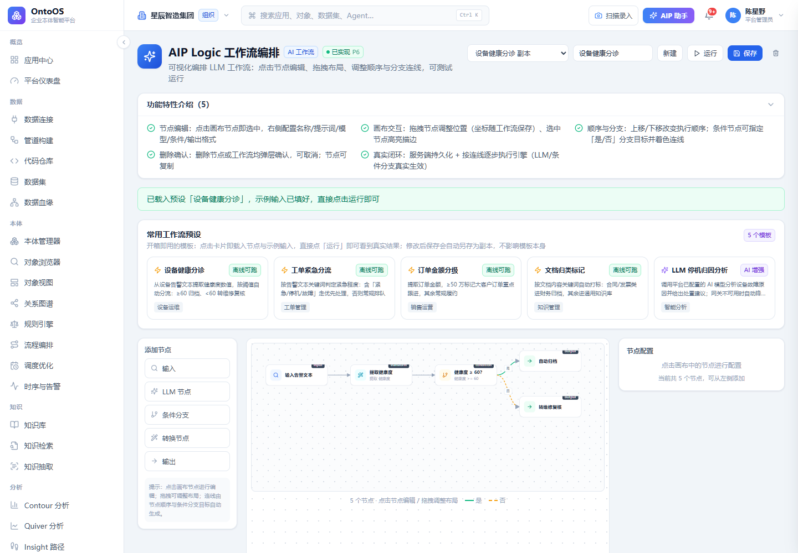

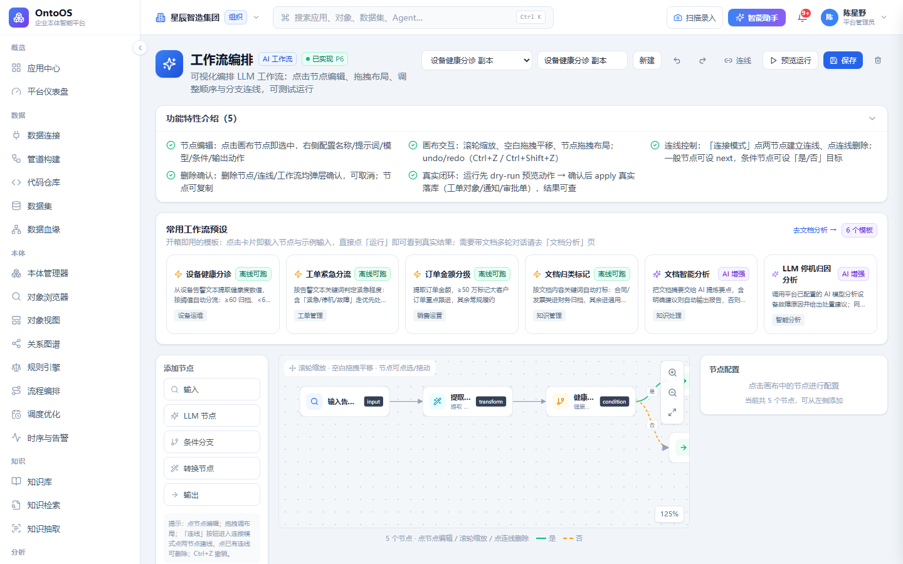

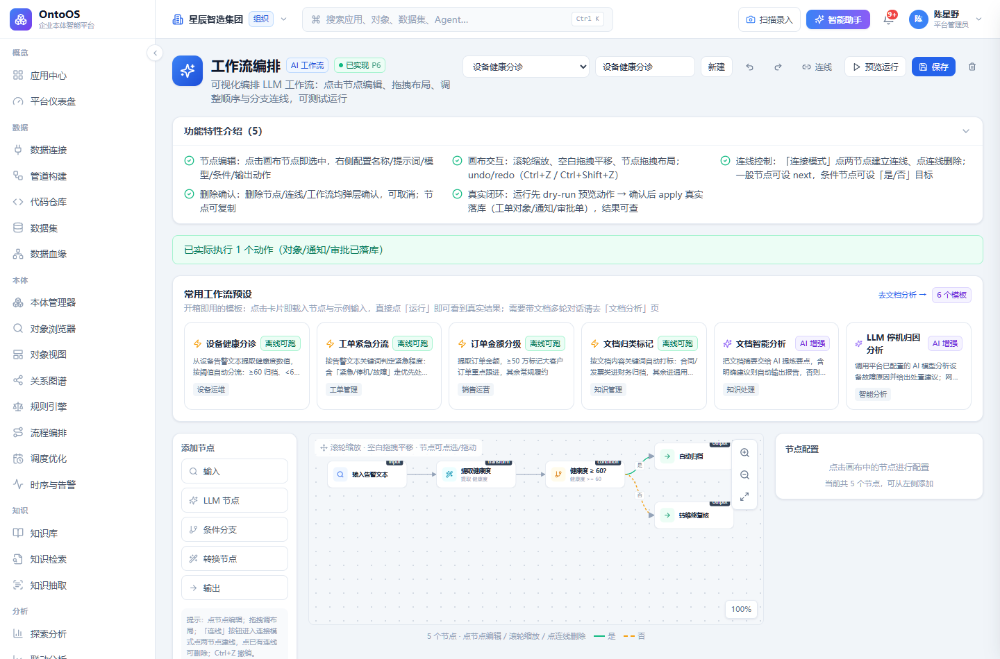

#### ㉜ 智能体构建 `/aip/agents`

- **功能**：Agent CRUD（空间隔离）、工具勾选、护栏（敏感脱敏 / 动作需人工确认）、系统提示词、对话测试与历史。
- **原理**：配置 JSON 存 `ai_conversations(scene='agent')` + 首条 `role:'system'` 消息（`aip.ts:35-180`）；`server/engine/agentTools.ts` 按关键词 `wants()` 推断调用 6 类工具，`mask()` 对 `SENSITIVE_KEYS` 打 `前2***后2`；工具结果拼入 prompt 强制「基于此回答，不要编造」；`semanticGuard` 拒答。
- **边界**：工具由**关键词推断而非 function-calling**；`execute_action` 从不真实写库；`maskSensitive` 开关在 `agentTools.ts:70` 两分支相同、**实际恒定生效**；仅 `send_notification` 真实落库；对话测试无本地降级（502）；无流式/多轮 tool 循环。
- **验证**：smoke Agent CRUD + chat；load.mjs `设备运维助理`。

#### ㉝ 文档分析 `/aip/threads`

- **功能**：选知识库文档 + 任务 → 真实 AI 结构化分析；**带文档上下文与历史的多轮追问**；引用文档标签；失败保留草稿 + 一键重试；删除二次确认。
- **原理**：`aip.ts:182-335`：`buildDocContext()` 把文档正文（截断 5000 字）以 `role:'system'` 持久化；`POST /threads` 失败返回 `{error, retryable:true}` 502 并保留会话；`POST /:id/retry` 从 system/user 消息恢复重跑；`POST /:id/followup` 拼「文档上下文 + 历史对话 + 追问」调 LLM 并双写消息；`GET /:id` 返回 `pendingRetry` 且**不暴露 system 上下文**；前端对话气泡 + 乐观追加/失败回滚。
- **边界**：不降级（网关失败明确报错，不伪造结果）；上下文截断 5000 字；追问把全部历史拼入（无窗口裁剪）；无附件解析/段落级引用定位。与「工作流编排」的分工见 [§4.2](#42-函数沙箱与工作流)。
- **验证**：smoke 195 中草稿保留/retry/followup 契约；截图 `doc-analysis.png`。


#### ㉞ 模型评估 `/aip/evals`

- **功能**：测试集（输入/期望输出/类别）编辑 → 真实 LLM 回答 → 关键词重叠评分；历史结果 Tab（达标线 0.6）、模型对比柱图、得分分布/均值/标准差、重跑回归。
- **原理**：`POST /p10plus/evals/run`（`p10plus.ts:70-92`）最多 10 条用例，逐条 `llmComplete`，评分 = 期望词与回答词双向 `includes` 重叠率，异常记 `score:0`；`GET /p10plus/evals` 从 `ai_messages.conversationId.startsWith('EVAL-')` 读取历史。
- **边界**：**运行不落库**，且仓库无代码写入 `EVAL-` 会话 → 历史列表/模型对比在纯运行态为空；评分是关键词重叠非语义/人工评测；`model` 恒为 `'LLM'`（「模型对比」实际只有一组）。
- **验证**：smoke `POST /p10plus/evals/run`。

#### ㉟ 模型管理 `/aip/models`

- **功能**：已接入模型卡片（真实 AI/嵌入配置）、AI 回复调用量（今日/7日/30日）、连通测试、AI 服务配置注册、BYOM 模型编目 CRUD + 配额。
- **原理**：`GET /p10/models`（`p10.ts:64-104`）读 `settings('ai'/'embedding')`，`tokenUsage` 按 `ai_messages.role==='assistant'` 条数聚合；**AI 配置保存回显**：`PUT /ai/config`（`ai.ts:125-135`）写 `settings` + 审计，`GET /ai/config` 返回 `{endpoint, model, apiKey:''}` —— **密钥永不回显**，前端显示「已保存（不回显，留空即沿用）」；BYOM 编目落 `model_registrations`。
- **边界**：BYOM 注册**仅编目/配额，不切换线上推理端点**（页面明示）；`tokenUsage` 是回复条数非 token；无配额 enforcement / 多模型路由 / 灰度。
- **验证**：smoke `/ai/config` 保存回显与密钥不回显；load.mjs 模型注册。

#### ㊱ 开发者工具 `/aip/developers`

- **功能**：服务端点清单（一键复制）、AI 工具清单、AI 服务配置只读展示、API 密钥 CRUD（明文仅创建时显示一次，列表只显前缀）。
- **原理**：`server/routes/governance.ts:60-92` 创建 `ontoos_<48hex>`，库里只存 `keyHash = sha256(raw)`、`prefix`、`scope`；`server/auth.ts:65-81` 校验 `loadApiKeyUser()`：`createHash('sha256')` 比对，`read` scope 仅允许 `GET|HEAD|OPTIONS`，身份映射到 `ownerId` 并更新 `lastUsedAt`。
- **边界**：端点与工具清单是**硬编码 4 端点 / 6 工具**，与 `AI_TOOLS` 22 个契约不是同一数据源；`write`/`all` scope 后端行为等价（仅判断 `==='read'`）；密钥无过期/轮换/空间级细粒度 scope。
- **验证**：smoke API 密钥 read 限读 / write 可写 / 删除失效闭环。

#### ㊲ 智能助手（全局侧滑，非独立路由）

- **功能**：22 工具对话式操作平台；ChatBI 对话内出图（折线/饼图/条形/交叉热力表 + 同比环比对比卡）；主动澄清；会话持久化；多空间快捷示例；双引擎降级。
- **原理**：完整链路见 [§4.1](#41-智能助手与语义层) 与 [§4.3](#43-chatbi-与聚合引擎)。
- **边界**：最多 4 轮工具循环；图表仅最近 12 / 前 8 组；`cites` 协议字段未渲染来源 chips；本地引擎只能发起约 14 个工具（其余需 LLM 模式）；网关 429 时降级本地引擎。
- **验证**：smoke 195 项；3 张 ChatBI 截图（`aip-chatbi.png` / `-trend.png` / `-cross.png`）。

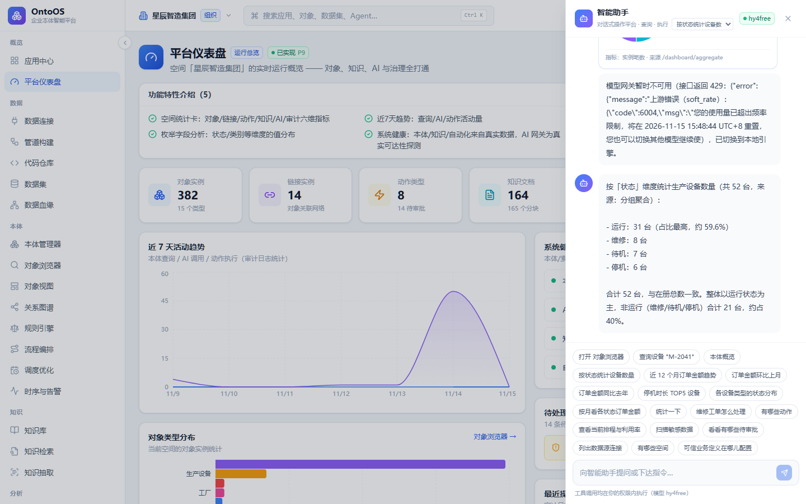

---

### 3.5 治理与管理（6 个）

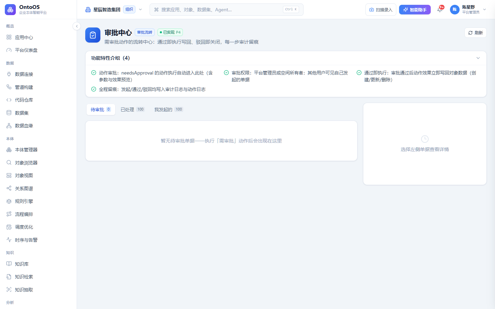

#### ㊳ 审批中心 `/gov/approvals`

- **功能**：需审批动作的流转中心；通过 → 真实写回、驳回 → 关闭，每一步写审计；Tab（待审批/已处理/我发起的）。
- **原理**：`server/routes/actions.ts`：执行 `needsApproval===1` 的动作先落 `approvals`（`payload` 存动作参数），`POST /actions/approvals/:id/decide`（:243+）`approve` → 走 `applyEffect` 真实写对象 + `action_logs(done)`；`reject` → `action_logs(rejected)`；全程 `audit_events` 留痕。权限：`spacePerm(user, space, targetTypeId)==='full'` 才能执行（:169）。
- **边界**：审批流是单级（无多级会签/加签/条件分支审批人）；审批人权限为平台管理员或空间所有者。
- **验证**：smoke「发起需审批动作 → 审批同意 → 数据变化 → 审计留痕」四环；截图 `approvals.png`。

#### ㊴ 审计日志 `/gov/audit`

- **功能**：全平台操作检索、按类型/时间筛选、详情展开。
- **原理**：`server/routes/admin.ts` / `governance.ts` 读 `audit_events`；几乎所有写操作（建模、对象、动作、审批、AI、网关配置、扫描、工作流）都调用统一 `audit()` 写入。
- **边界**：`audit_events` 无 space_id 列（曾误建索引报错已删），空间隔离靠 `target` 字符串前缀约定，非结构化外键；无日志归档/外发 SIEM。
- **验证**：smoke 审计端点；截图 `audit.png`。

#### ㊵ 安全与标记 `/gov/security`

- **功能**：Markings 标记统计（真实）；脱敏规则、敏感扫描发现、生命周期策略三张表 CRUD；掩码预览、扫描执行、生命周期到期检查并留痕。
- **原理**：`server/routes/platformOps.ts` / `governance.ts` 三表真实 CRUD；`p10.ts:50-58` 的 `governance.enabled=false` 明确标注「产品示意，本地版本尚未接入对应引擎」，返回 `null`/空数组而不伪造数字；后续批次已补真实扫描/掩码预览/到期检查执行记录（`governance_runs`）。
- **边界**：**缺查询管道实时掩码、自动调度器**；无列级加密/密钥管理/KMS；管理页部分面板仍是产品示意（如实标注）。
- **验证**：load.mjs 治理三表；smoke 治理端点。

#### ㊶ 用户与权限 `/admin/users`

- **功能**：用户 CRUD、角色与用户组、邀请（链接/邮件）、应用与对象权限按角色收敛。
- **原理**：`server/routes/users.ts` / `roles.ts` / `auth.ts`；JWT(HS256) + bcryptjs 密码哈希；`buildSessionUser()` 把角色 `objectPerms` / `appPerms` 注入会话；邀请写 `users(status=invited)` + 可选 SMTP 发信。
- **边界**：**JWT 无服务端吊销**（改密码/禁用需等 token 过期）；无 OIDC/LDAP/SSO/会话表；密码策略为 bcrypt + 最小长度，无 MFA/密码轮换。
- **验证**：smoke 用户/角色/邀请；截图 `users.png`。

#### ㊷ 实现进度 `/admin/roadmap`

- **功能**：42 页实现阶段与状态总表、阶段进度条、验收标准、升级触发条件。
- **原理**：`src/config/status.ts` 为**单一事实来源**（`PAGE_STATUS` 42 条），`computePhaseProgress()`（:50-63）依据状态实时派生进度，避免「阶段标完成但页面仍 mock」；PageShell 徽章 / Launcher 圆点 / 本页三处共享。
- **边界**：状态是人工维护的元数据（改功能须同步 `status.ts`），非运行时自动探测；新增页面不登记则不计入进度。
- **验证**：`FEATURE-MATRIX.md` 42 页矩阵；截图 `roadmap.png`。

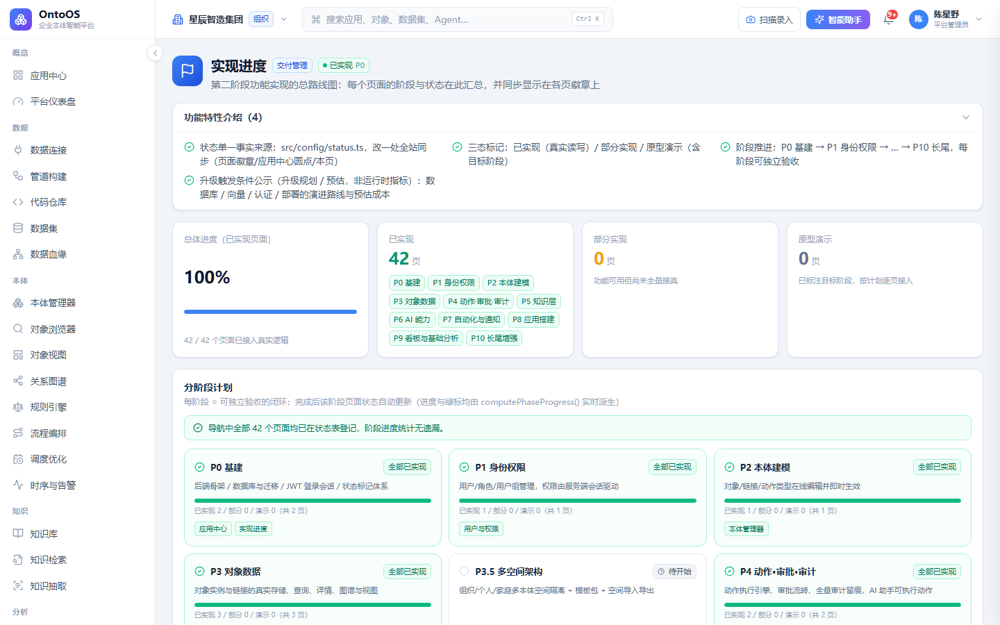

#### ㊸ 控制面板 `/admin/control`

- **功能**：功能开关、用量配额与服务可观测性；SMTP / AI / 嵌入 / 视觉四张配置卡保存后回显已保存概览；AI 网关真实可达性探测（2.5s 超时）；环境信息。
- **原理**：`server/routes/admin.ts:71-139`（嵌入 / 视觉 / 功能开关四组 `settings` 读写）+ `ai.ts` 的 `GET/PUT /ai/config`；配置落 `settings`（JSON 值），`apiKey` 永不回显；用量按 `ai_messages` / `objects` 真实计数。
- **边界**：探针把任何 HTTP 响应（含 401/404）算「可达」；无 P99 真实链路追踪（页面「可观测性」为统计卡级别）；SMTP 发信依赖外部邮箱配置。
- **验证**：smoke 配置保存回显；截图 `control-panel.png`（**已裁去配置表单，避免邮箱/端点入公开仓库**）。

#### ㊹ 识别模板 `/admin/scan-templates`

- **功能**：5 个内置模板（消费小票/增值税发票/订单截图/快递单据/通用票据）+ 自定义模板 CRUD；字段映射在线编辑；自动匹配建议。
- **原理**：`server/engine/scanTemplates.ts`：`autoMatchTemplate()` 四级（① typeId 绑定的 custom 模板 ② 内置关键词命中最多 ③ `sceneByType` 按类型名推断 ④ 通用兜底）；`buildPrompt()` 按目标类型属性生成严格 JSON 输出格式（含枚举/数字/日期约束、明细 `items`）；`applyMapping()` 把模型输出键映射到本体属性 key。落 `scan_templates`。
- **边界**：靠关键词与类型名推断，**无置信度阈值/学习**；扫描识别本身完全依赖视觉/文本 LLM（无本地 OCR）；批量上限 10 张、图片 max_tokens 1000 / 60s。
- **验证**：load.mjs 自定义模板；smoke 字段映射不清空。

#### ㊺ 部署发布 `/admin/apollo`

- **功能**：本地部署编排状态机（dev→staging→prod 记录、晋升、回滚、冻结窗口、集群派生）、发布计划甘特、多集群版本管理。
- **原理**：`server/routes/apollo.ts`：真实落 `deployments` / 集群派生表；`POST /promote/:id` 生成新环境记录并回指 `previous_id`，`POST /rollback/:id` 依据 `previous_id` 回退；冻结窗口规则（每月 8-9 日）真实校验；`POST /seed` 生成演示历史。
- **边界**：**本地编排状态机，非真实 K8s/CI-CD 执行**（页面与 status note 明确）；无容器编排/镜像仓库/流水线日志；集群是派生展示数据。
- **验证**：load.mjs 模块 6；smoke Apollo 端点。

---

## 四、横切能力

### 4.1 智能助手与语义层

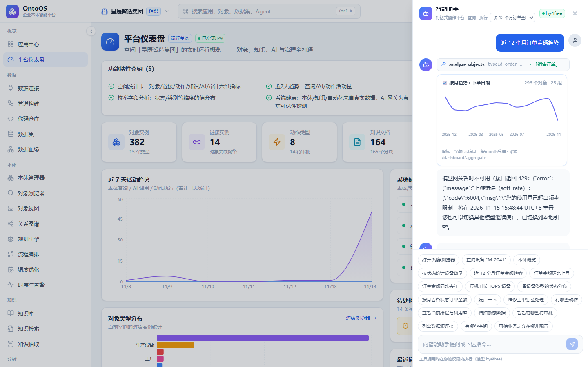

**22 个工具契约**（`shared/ai-tools.ts:9-181`，前后端共享）：`navigate` / `query_objects` / `ontology_overview` / `list_users` / `invite_user` / `execute_action` / `list_actions` / `search_knowledge` / `analyze_objects` / `ask_clarification` / `run_function` / `run_pipeline` / `get_schedule` / `governance_scan` / `manage_scenario` / `compare_objects` / `eval_derived` / `apollo_deploy` / `collect_timeseries` / `sync_source` / `decide_approval` / `space_action`。

**function-calling 循环**（`AssistPanel.tsx:455-537`）：`POST /ai/chat` → `toolCalls` → 前端 `runTool()` 逐一映射真实 REST API → `role:'tool'` 回灌 `history` → 最多 4 轮；`navigate` / `ask_clarification` / 全失败熔断为终态。

**双引擎**（`ai.ts:170-197`）：有 AI 配置 → OpenAI 兼容 `/chat/completions`（`tool_choice:'auto'`，60s 超时）；无配置或 429/超时 → 本地正则意图引擎，且**保留 `toolCalls`**；尾部 `role:tool` 直接汇总收口避免死循环。

**语义层守卫**（`server/engine/semantic.ts:70-83`）：仅当空间存在已认证术语、问题命中指标词、未命中术语、非明细查询/导航、非 ChatBI 正则时**拒答并列出可用术语**（不猜测口径）；`resolveTerms` 是纯子串匹配（非向量）；认证口径摘要注入 system prompt。ChatBI 分组聚合按「对象已定义属性」放行。

**systemHelp 前置拦截**（`ai.ts:320-341`）：12 条功能映射，问「某功能在哪儿配置 / 怎么用」直接给路径 + `navigate`，不绕数据工具。

**中文导航兼容**：`NAV_HINTS` 41 条（中文名 + 英文别名 keywords）+ 前端 `LEGACY_PAGE_NAMES` 18 个旧英文产品名映射，菜单中文化后历史问法仍能跳转。

### 4.2 函数沙箱与工作流

**node:vm 沙箱**（`server/engine/functionSandbox.ts`）：每次执行 `runInNewContext` 全新 realm；`timeout:2000` + `contextCodeGeneration:{strings:false, wasm:false}`；只注入 `input/Math/JSON/Date/String/Number/Array/Object`，显式屏蔽 `require/process/global/fetch/eval/Function`；`HARDEN` 抹掉 `constructor.constructor` 逃逸链；结果 `normalize()` 处理 undefined/BigInt/循环引用；始终返回 `{ok,result,error,durationMs}`。版本链路：草稿自动测试 → publish/rollback 移动发布指针 → `run` 执行已发布版本。

**工作流预设**（`shared/workflowTemplates.ts`）：6 个模板，4 个 `needsLlm:false`（`transform` + `condition` 全离线确定性分流：设备健康分诊 / 工单紧急分流 / 订单金额分级 / 文档归类标记），2 个 AI 增强（文档智能分析 / LLM 停机归因）。条件节点按 `nextYes/nextNo` 真实跳转、一般节点按显式 `next` 连线跳转、`visited` 防环、20 步上限；LLM 节点失败降级规则摘要并标 `branch:'degraded'`；`output` 为终点不串行执行；保存预设自动另存副本。**真实动作闭环**：每个预设的 output 节点挂 `create_object` / `send_notification` / `create_approval`，`mode=preview` 只预览不落库，用户确认后 `mode=apply` 才写工单对象 / 通知 / 待审批单并返回 `refId`，页面展示「已执行的业务动作」。编辑侧支持 undo/redo、连接模式建线、点连线删除确认、缩放平移。

**文档分析 vs 工作流编排（分工）**：文档分析 = 带知识库文档上下文的**多轮对话**（`followup` / 草稿 `retry`）；工作流编排 = **可复用、可编排、一次跑完**的处理链。两页互相导流。

### 4.3 ChatBI 与聚合引擎

`GET /dashboard/aggregate`（`dashboard.ts:125-320`）是 Contour 与智能助手共用的单一聚合口径：

| 参数 | 语义 |
|---|---|
| `typeId` / `groupBy` / `metric` | 单类型、按属性分组、可选数值求和（无 metric 则笔数） |
| `bucket=day\|week\|month\|quarter` | 日期分桶（默认 month，非法值也退化为 month）；时间序列默认**按时间升序** |
| `from` / `to` | `YYYY-MM-DD` 时间窗（依赖该类型有 date 属性，否则静默忽略） |
| `sort=count\|sum\|avg\|name` + `order` | 非时序默认 sum 降序（金额最大优先） |
| `top=N` | 排序后取前 N（钳 1..50） |
| `compare=prev\|yoy` | 需带 `from/to`：`prev` 紧邻等长上期、`yoy` 去年同窗；返回 `{current,previous,delta,deltaPct}` |
| `crossBy=第二维度` | 二维交叉矩阵（行=groupBy、列取总和前 12、单元格 sum/count）；与 `compare` 互斥 |

**实现**：`where(and(eq(spaceId), eq(typeId)))` 下推 SQL，但 **GROUP BY 在 JS 内存 Map 归约**；`compare` 会重跑一次窗口扫描；`crossBy` 同时累积二维 Map。

**图表自动选择**（`AssistPanel.tsx:623-728`）：`a.cross` → 交叉热力表（单元格 rgba 深浅）；`isTime` → 折线图（最近 12 组）；无 metric + 2~6 组 → 饼图；其余 → 条形图；`a.compare` → 本期/上期/↑↓ 对比卡。时间序列图表与给 LLM 的文本**统一取最近 12 组**（曾出现图表取最早 12 组导致口径不一致的 bug，已修）。

**能力边界**：单表单类型、无多表 join / 无子查询 / 无流式游标 / 无分页；聚合仅 count/sum/avg（无 min/max/distinct/分位数）；无 HAVING / 多指标 / 三维以上；时间桶无空桶填充、一律 UTC；`metric` 未强制数值类型（文本字段静默跳过）。

### 4.4 动作引擎四环闭环

```
发起动作（校验参数 + spacePerm=full）
   ├─ needsApproval=0 → applyEffect 真实写 objects / links → action_logs(done) → audit_events
   └─ needsApproval=1 → approvals(待审批)
                          ├─ approve → applyEffect 写回 + done + 审计
                          └─ reject → rejected + 审计（不写业务数据）
```

`applyEffect` 支持 create/update/delete/link 四种效果；`server/engine/automation.ts` 的 `applyEffectDeps` 复刻同一套效果，避免与 `actions.ts` 循环引用。对象变更后 `fireObjectEvent` 触发自动化规则（notify / create_action / hold_approval）。

### 4.5 数据规模与性能

| 机制 | 实现 | 实测 |
|---|---|---|
| 热点索引 | `migrate.ts:146-152` 幂等 7 个（objects space+type / space+updated，links source/target，audit created，doc_chunks doc，ts_points metric+t） | — |
| SQL 下推 | `GET /objects` 空间/类型/游标/关键词在 DB 侧；`limit` 上限 200，`hasMore/nextCursor` | 10 万行列表 0.3ms |
| 事务批量导入 | `POST /objects/bulk` prepared statement + transaction + 幂等去重，单次 ≤20 万行 | 10 万行灌入 726ms |
| count / 关键词 | `count(*)` 5.4ms / 关键词 LIKE 53.8ms（10 万行） | `demo-data/stress.mjs` |

**边界**：`values` 是 JSON 文本，`LIKE '%…%'` 无法走索引；`GET /search` / `GET /graph` / `/dashboard/aggregate` / `overview` 仍是全表读入内存 JS 过滤；非列存 OLAP，亿级不可达。

### 4.6 验证体系

| 资产 | 规模 | 说明 |
|---|---|---|
| `tests/smoke.mjs` | **195 断言 / 0 失败** | 零依赖黑盒：登录 → 60+ 读端点 → 写闭环 → 权限 → 外部源 → ChatBI → 沙箱 → 分页/批量 → 预设/追问 |
| `demo-data/load.mjs` | **118 项幂等** | 24 个月订单时序（季节波动 + 年增 18%）、2 个工作流、6 预设、外部库、24 扫描素材 |
| `demo-data/stress.mjs` | 10 万行基准 | 灌入/列表/count/关键词延迟，自动清理 |
| `demo-data/FEATURE-MATRIX.md` | 42 页矩阵 | 功能 ↔ 验证数据 ↔ 体验步骤 |
| `tests/checklist.md` / `e2e-scenarios.md` | 42 页清单 / 10 剧本 | 人工验收 |
| `docs/screenshots/` | 29 张 | 真实界面截图 |

---

## 五、能力边界总表

| 类别 | 已实现（真实） | 明确边界 / 未接入 |
|---|---|---|
| 数据源 | SQLite 外部库 + CSV/JSON/TXT/MD 文件源（白名单只读、探测/预览/同步） | PG/MySQL/Kafka/SAP 仅登记；预览 20 行 / 同步 500 行；无凭据代理 |
| 本体 | 类型/链接/动作/接口/术语 CRUD、契约校验、函数沙箱版本/发布/回滚/run | 仅 JS 函数、2s 超时；缺 TS/Python、单测、动作支撑、SQL 分析 |
| 数据规模 | 索引 + SQL 下推 + 游标分页 + 事务批量（10 万行毫秒级） | 非列存 OLAP；亿级不可达；部分页面全表内存过滤 |
| 知识 | 分块(260/50 重叠) + BM25 + 向量余弦 + RRF；远程 embedding + 本地 256 维哈希降级 | 本地哈希非语义；不解析 PDF；两路各 30 条上限；换模型需重建索引 |
| 分析 | 单类型分组聚合、分桶、时间窗、排序、TOP-N、同比环比、二维交叉 | 无多表 join / 无子查询 / 无流式 / 无 HAVING / 无空桶填充；聚合仅 count/sum/avg |
| AI 助手 | 22 工具 function-calling、双引擎降级、语义守卫、ChatBI 四形态出图、主动澄清 | 最多 4 轮循环；本地引擎仅约 14 工具；`cites` 未渲染；图表仅前 8/最近 12 组 |
| 工作流 | 6 预设（4 离线）、可视化编辑（undo/redo/连线控制/缩放）、分支与显式 next 跳转、dry-run→apply 真实动作（工单/通知/审批单）、另存副本 | 无并发/定时触发/版本管理；连线仅单 next + 两分支（无并行/汇聚）；`model` 字段未用；`create_object` 默认 ticket 类型；2 个预设依赖网关 |
| 文档分析 | 多轮追问、草稿保留/retry、引用文档标签 | 不降级（明确报错）；上下文 5000 字截断；无段落级引用 |
| Agent | CRUD、护栏、工具结果注入、对话测试 | 关键词推断非 function-calling；`execute_action` 不真实写库；`maskSensitive` 开关失效；无降级 |
| 调度 | 本地贪心启发式求解、冲突、应用、指标、甘特 | **非 COPT/OR-Tools 最优解**；7 天视界；不接外部排产主数据 |
| 时序 | `ts_points` 真实采集/序列查询、规则启停 | 24h 模拟曲线是确定性数学波动；无设备直连 / streaming |
| 部署 | 本地编排状态机（晋升/回滚/冻结窗口/集群派生）真实落库 | **非真实 K8s/CI-CD 执行** |
| 治理 | 审批四环闭环、全量审计、脱敏规则/扫描发现/生命周期三表 CRUD 与执行记录 | 缺查询管道实时掩码、自动调度器；部分面板产品示意（如实标注） |
| 认证 | JWT + bcryptjs + API 密钥(SHA-256/scope) | **JWT 无吊销**；无 OIDC/LDAP/SSO/MFA；密钥无过期/轮换 |
| 基础设施 | 单进程、单文件 SQLite、一条命令启动、零外部依赖 | 无 PG/pgvector/PM2/K8s、无部署级多租户隔离、无 SLA |

> 详细对标差距清单（本地保留、不入库）：`docs/local-benchmark.md`。

---

## 六、附录

### 6.1 路由组清单（28 个，`server/index.ts:38-65`）

`/api/auth` `/api/users` `/api/roles` `/api/admin` `/api/ai` `/api/objects` `/api/ontology` `/api/spaces` `/api/actions` `/api/automations` `/api/knowledge` `/api/workshop` `/api/extract` `/api/dashboard` `/api/aip` `/api/p10` `/api/p10plus` `/api/p10long` `/api/gov` `/api/data-layer` `/api/logic` `/api/scan` `/api/scan-session` `/api/fn` `/api/explorations` `/api/ops` `/api/scheduling` `/api/apollo`

### 6.2 引擎清单（8 个，`server/engine/`）

`automation.ts`（规则触发） · `knowledge.ts`（分块/BM25/向量/RRF） · `semantic.ts`（认证术语守卫） · `agentTools.ts`（Agent 工具护栏） · `externalSource.ts`（SQLite 外部源白名单） · `fileSource.ts`（CSV/JSON/TXT/MD 解析） · `functionSandbox.ts`（vm 沙箱） · `scanTemplates.ts`（识别模板自动匹配）

### 6.3 快速开始

```bash
npm install
npm run db:migrate       # 幂等建表 + 索引 + 空间回填
npm run seed             # 演示数据
npm run dev              # 前端 5174 + API 5000
python demo-data/build_external_db.py
node demo-data/load.mjs  # 118 项验证数据集
node tests/smoke.mjs     # 195 项黑盒断言
```

默认账号 `chen.xingye / ontos@2026`；顶栏可切换组织 / 个人 / 家庭空间。

### 6.4 截图索引

> 全部截图位于 `docs/screenshots/`，均为 1440×900 真实界面截图；下表为文件名。

| 截图 | 内容 | 截图 | 内容 |
|---|---|---|---|
| `login.png` | 登录页 | `launcher.png` | 应用中心 |
| `overview.png` | 平台仪表盘 | `roadmap.png` | 实现进度 |
| `ontology-manager.png` | 本体管理器 | `object-explorer.png` | 对象浏览器 |
| `graph.png` | 关系图谱 | `scheduling.png` | 调度甘特 |
| `knowledge-search.png` | 知识检索 | `knowledge-library.png` | 知识库 |
| `contour.png` | 探索分析 | `aip-chatbi.png` | ChatBI 条形图 |
| `aip-chatbi-trend.png` | ChatBI 趋势折线 | `aip-chatbi-cross.png` | ChatBI 交叉热力表 |
| `aip-logic-presets.png` | 工作流预设 | `aip-logic-zoom.png` | 工作流画布缩放 |
| `aip-logic-actions.png` | 工作流真实动作结果 | `doc-analysis.png` | 文档分析 |
| `data-connections.png` | 数据连接 | `datasets.png` | 数据集 |
| `machinery-editor.png` | 流程编排编辑器 | `pipelines-editor.png` | 管道节点编辑器 |
| `lineage.png` | 数据血缘 | `approvals.png` | 审批中心 |
| `audit.png` | 审计日志 | `control-panel.png` | 控制面板（已裁去敏感配置） |
| `users.png` | 用户与权限 | `workshop.png` | 应用搭建 |
| `marketplace.png` | 应用市场 | | |

### 6.5 相关文档

- [README.md](../README.md) — 产品图文介绍与快速开始
- [PROJECT-STATUS.md](./PROJECT-STATUS.md) — 项目状态报告（完成度评估、遗漏任务、路线图）
- [CONVENTIONS.md](../CONVENTIONS.md) — 页面开发规范（诚实标注、状态单一事实来源）
- [FEATURE-MATRIX.md](../demo-data/FEATURE-MATRIX.md) — 42 页验证矩阵
- [api-contract.md](../tests/api-contract.md) — 端点契约
- `docs/local-benchmark.md` — 对标差距清单（**本地保留，已 gitignore，不入库**；不提供仓库内链接）

---

<div align="center">

**OntoOS 技术文档** · 与代码同仓维护 · 数据以运行时真实状态为准

</div>
